# abhyasa


<!-- WARNING: THIS FILE WAS AUTOGENERATED! DO NOT EDIT! -->

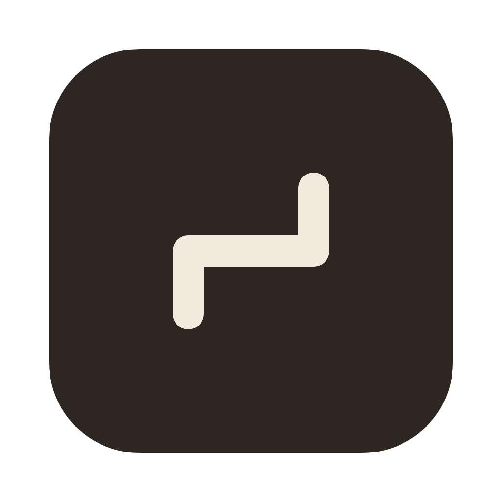

[](https://github.com/vedicreader/abhyasa/releases/download/mac-v0.0.15/Abhyasa.zip) [All releases](https://github.com/vedicreader/abhyasa/releases)

[](https://github.com/vedicreader/abhyasa/actions/workflows/test.yaml)

abhyasa (अभ्यास) is Sanskrit for “steady practice”. It is an app that helps you learn a hard subject well.
You give it a goal or a source, such as a paper, a book or your notebooks. It makes a walk through the big ideas,
explains each idea at your level, and asks checks that test your understanding. It grades the idea in your own words.

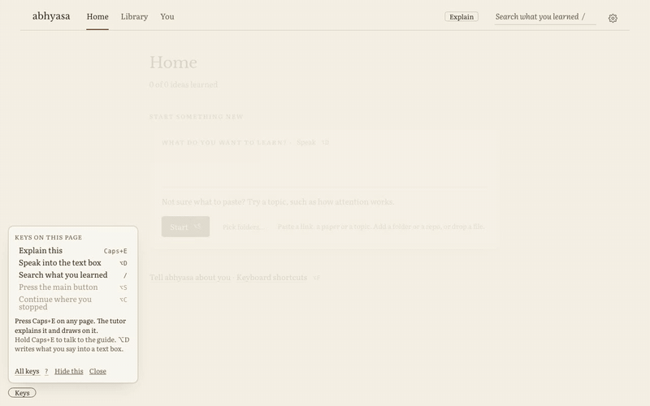

When you do not get a part of a page, the screen guide explains it and draws on the page. When an idea is easier to
learn with code, Leela opens it as a notebook. The app needs macOS 26 on Apple Silicon. The tutor uses a language model
that you pick, such as Claude, GPT or a local model.

## Install

### The Mac app

``` sh
brew install --cask vedicreader/tap/abhyasa
```

The cask also installs uv. On the first start, the app uses uv to get Python and the abhyasa package. This step takes
some minutes. To get a new version, run `brew upgrade --cask abhyasa`. To remove the app, its settings and its Python
environment, run `brew uninstall --zap --cask abhyasa`. The zap keeps your vault, because other tools use it too.

You can also use the Download for macOS button at the top. Unzip `Abhyasa.zip`, move `Abhyasa.app` to Applications
and open it. The app needs uv: if you do not have it, run `brew install uv`. Each release has a Developer ID
signature, and Apple notarized it.

### From PyPI

``` sh
uv tool install abhyasa
abhyasa
```

Then open <http://127.0.0.1:5077>. For the natural voice and for speech to text on your Mac, install the extras:
`uv tool install 'abhyasa[voice,whisper]'`. To run from a clone, see [Run from source](https://vedicreader.github.io/abhyasa/reference.html#run-from-source).

## Your first walk

This tour takes about 3 minutes. The pictures come from a new vault with one public paper,
[Attention Is All You Need](https://arxiv.org/abs/1706.03762).

### 1. Start a walk

On Home, put a link, a paper, a topic or a goal in the Start box. One line tells you what abhyasa will do with it.
Press Start (⌥S). abhyasa gets the source only when you press Start.

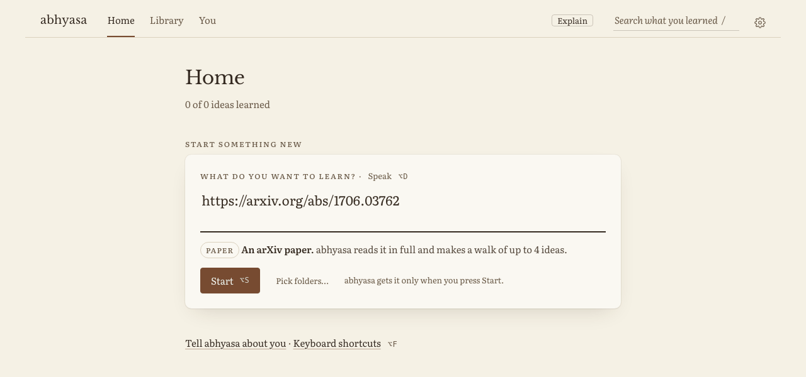

### 2. Look at the walk

The walk page shows the main claim of the source and its big ideas: 3 to 7 of them. Each idea shows its key question
and its kind of check. To change the walk, write what you want in the box, for example “make idea 3 simpler”, and push
Return. The tutor makes the change and shows Undo. Press Lock on an idea, and the box does not change it.

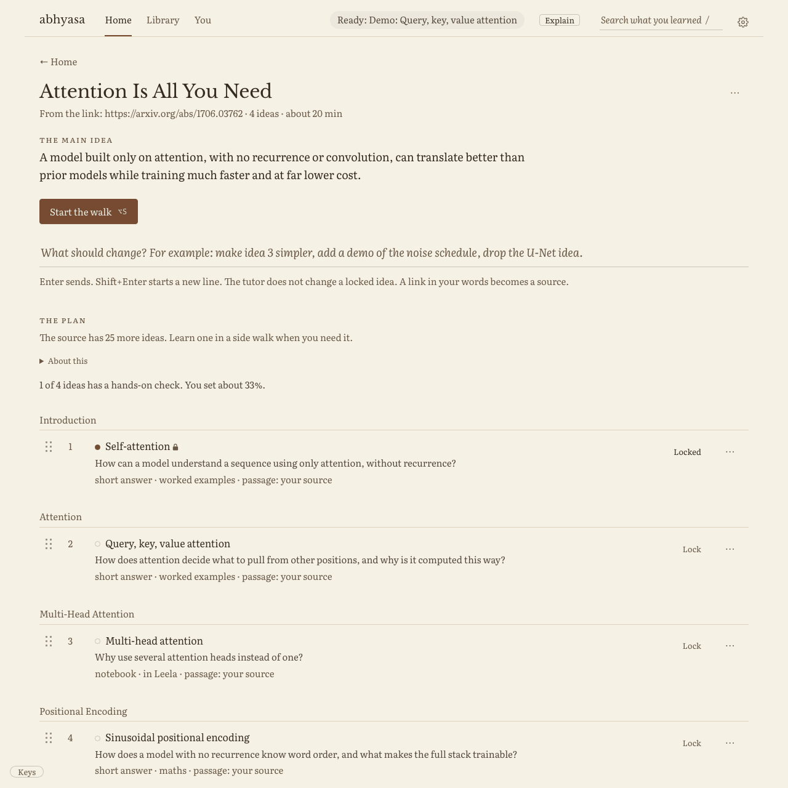

### 3. Read an idea

Each idea shows a passage from the source, word for word, with a link to its page. Words to know explains the terms.
The tutor’s note explains the idea at your level.

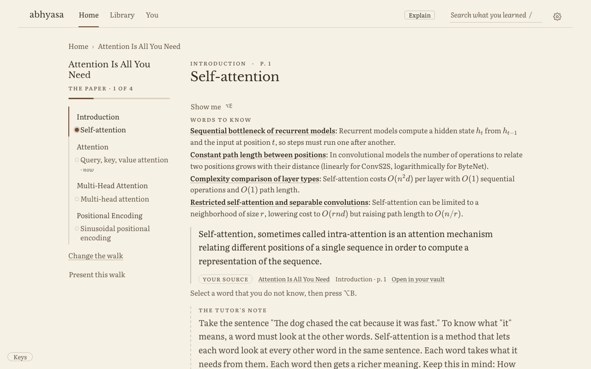

### 4. Answer the check

The check asks you to explain, predict, compare or apply the idea. It does not ask you to recall a fact. Say how sure you
are, then press Send. The core idea in any words passes. When your answer has a gap, the feedback names the gap and asks a
question that points to the fix. While you have tries left, it does not give the answer.

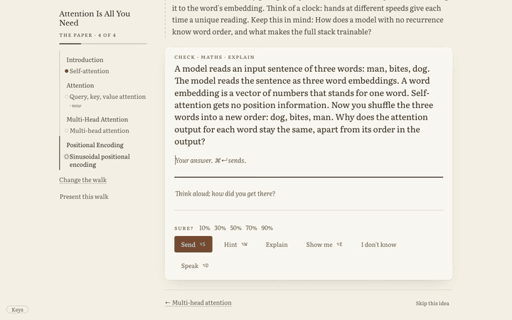

### 5. Ask the screen guide

Press Caps+E (⌃⌥⇧⌘E) or Explain in the top bar. Then say or type what you do not get. The tutor answers on the page,
as a teacher does at a whiteboard. It circles words, speaks one short line for each step, and draws a diagram in the side
panel. D goes to the next step, S goes back, A says the step again, and Esc stops.

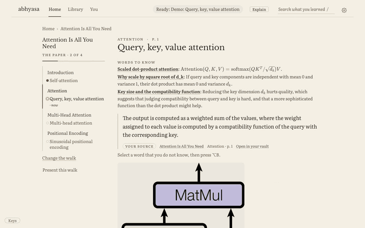

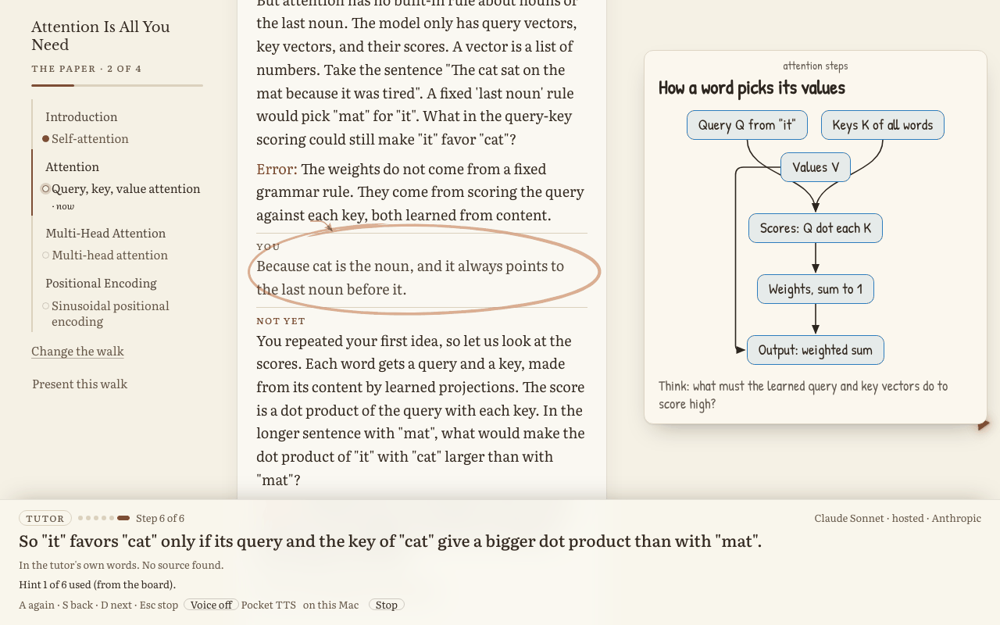

### 6. Try a demo

Press Show me (⌥E) on an idea. A demo asks you to predict first. Lock in your prediction (⌘↩). Then the demo shows the
result, and you can change the inputs.

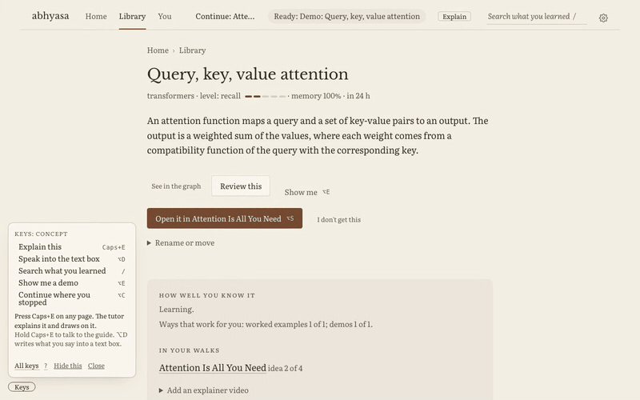

### 7. Open the code in Leela

An idea that you learn best with code has a notebook check. Open in Leela opens the notebook in
[Leela](https://github.com/vedicreader/leela), on the same walk and idea. abhyasa runs no code. What you do in Leela comes
back to the idea. When Leela is not running, the page tells you how to start it.

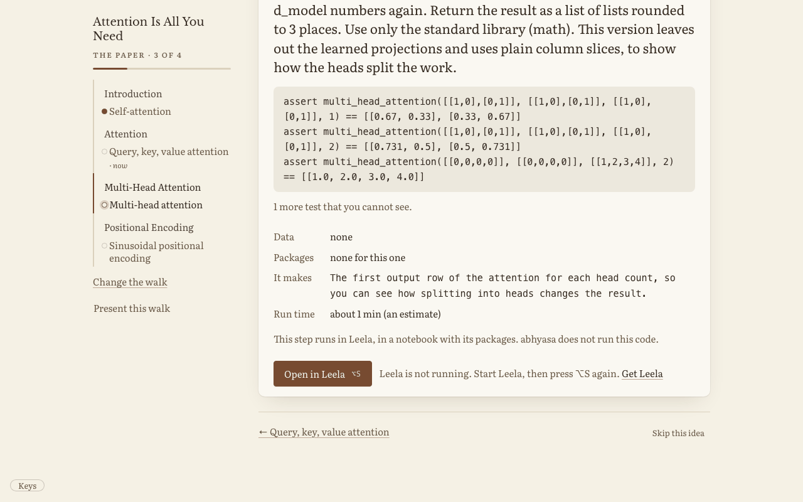

## Your level

abhyasa keeps a record for each idea: how deep you know it, how well you recall it now, and when to review it. The tutor
uses this record each time it teaches you. When an idea is new or shaky, the tutor writes simply, one step at a time, and
starts with your gap. When an idea is solid, the tutor is short and adds an edge case. The text that the tutor writes for
you is plain English at grade 9.

“Tell abhyasa about you”, on Home, adds your background, your goals and the examples that help you. Under You, you can
see and change all that abhyasa knows about you, and your strong and weak ideas.

## Sources and trust

A walk can come from a link (a web page, a documentation site, a PDF, an arXiv paper or a GitHub repo), a file that you
drop, a text that you paste, a folder of notebooks on your Mac, or a goal that names its sources. The passage on each
idea is word for word from its source, with a link. abhyasa keeps a passage only when its words are in the document.
When a text is the tutor’s own words, the page says so.

A walk from one of your notebooks follows the notebook: one idea for each section that teaches. abhyasa never writes
your notebook.

## Keys

All keys are for the left hand. ⌥ is the Option key.

| key            | what it does                                    |
|----------------|-------------------------------------------------|
| ⌥S             | press the main button: Start, Send or Next idea |
| ⌥W             | ask for a hint                                  |
| ⌥E             | Show me a demo                                  |
| ⌥B             | learn a missing idea in a side walk             |
| ⌥D             | speak into the text box                         |
| Caps+E (⌃⌥⇧⌘E) | ask the screen guide: hold to talk, tap to type |
| ⌥T, ⌥R, ⌥G     | go to Home, Library or You                      |
| ⌥F or ?        | show all the keys                               |

Each page also has a small Keys button at the bottom left. It shows the main keys of the page.

## Settings

The gear at the top right opens Settings. It has seven tabs: Models, Voice, Screen guide, Learning, Walks and talks,
Sources and Look. The defaults work well. Each number shows its range and its default.

- Models: the default model, and a different model for each task if you want one, such as questions, grades and hints.
  The default is Claude Sonnet. The list has hosted models and models that run on your Mac.
- Voice: the screen guide reads its steps aloud with Pocket TTS on your Mac (one download of 225 MB), with OpenAI
  (hosted, with your key) or with the browser. Speech to text runs on your Mac with Qwen3-ASR by default.

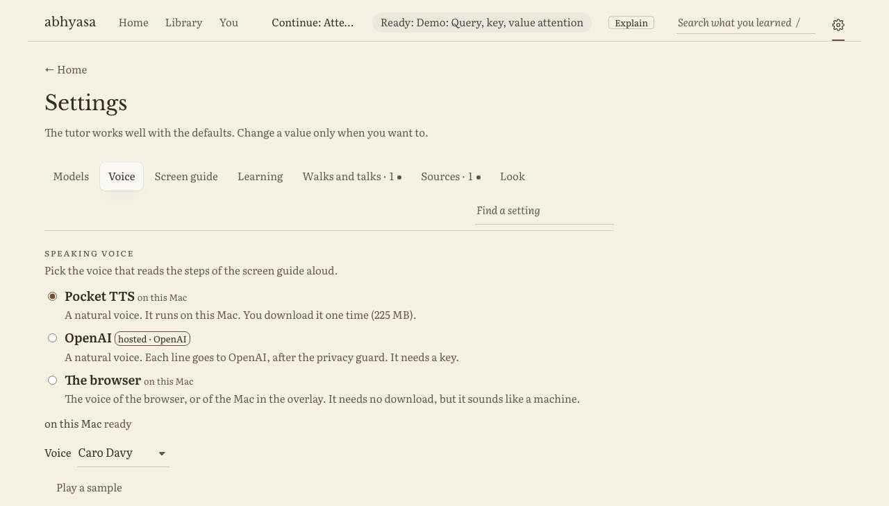

## Privacy

abhyasa runs on your Mac, and it answers only requests from your Mac. Your ideas, answers and walks are documents on the
`learning` shelf of your vault (`~/.vishalakshi/vault.db`), so your other tools can search them.

The question, your answer and the parts of the page that the tutor needs go to the model that you pick. A local model
keeps them on your Mac. To read a figure, the screen guide can send a picture of it to the model. abhyasa does not keep
the picture. All text to a model goes through ramabana’s guard, which always masks secrets. Speech to text runs on your
Mac by default. OpenAI speech sends your audio or text off your Mac, and it needs your key.

## More

The [reference](https://vedicreader.github.io/abhyasa/reference.html) has all the details:

- how one question works, from the pick of the idea to the lesson after a miss
- walks from a link, from a goal, from your folders and repos, with your data, and as a course
- how to change a walk, rabbit holes and side walks
- the screen guide in full, demos, and Open in Leela
- how to teach a topic to a group, as a talk
- all settings, all keys, how to run from source, and the speech models with their licences
- how to use the tutor from Python

The other pages of these docs describe the engine, one notebook for each part.

To maintain or change abhyasa, read [the decisions](https://github.com/vedicreader/abhyasa/blob/main/docs/decisions.md) and [how to develop](https://github.com/vedicreader/abhyasa/blob/main/docs/develop.md).
