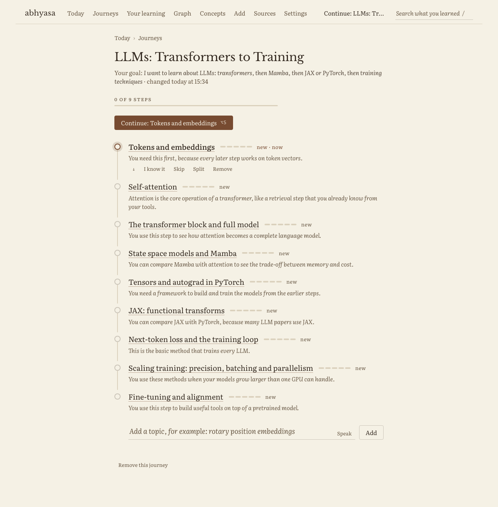
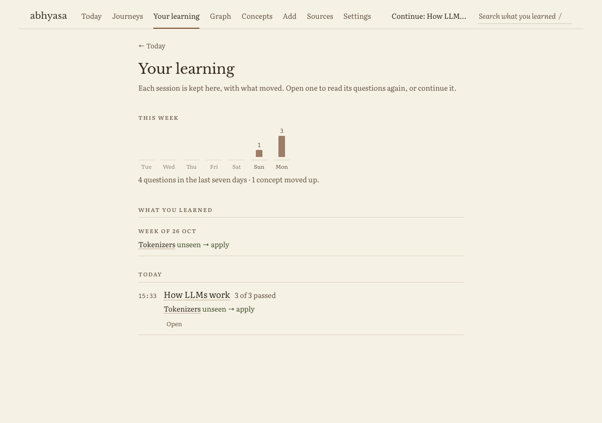
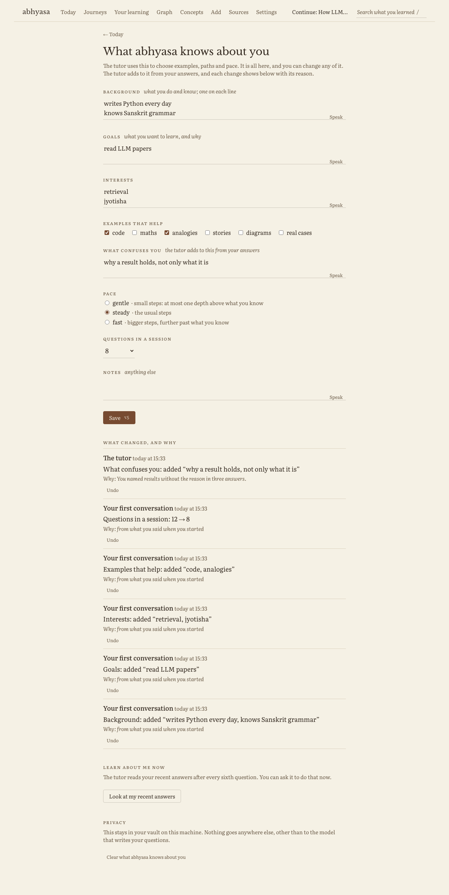

# abhyasa: the learner experience

Date: 26 October 2026. Status: designed and built on the branch `journeys`. The text "(my call)" marks a decision that I made.
Check these decisions first. They are listed again at the end.

## The problem, in the words of the user

"How do I go back and front in the app? I might click wrong and then get stuck in another page."
"I don't know what my previous learning runs were, what I learned, resuming them, how to then learn a related topic."
"If I want to learn about LLMs, I might want to learn a little about transformers, then Mamba, then JAX or PyTorch, then
machine learning techniques. Right now it's hard to switch and restart and know where I'm at."
"Have the audio button anywhere with questions. The product needs to actively learn about me."

What the app did before this change:

- A session lived only in memory (the `sessions` dict). A restart lost it. The summary was filed only at the end.
- No page listed past sessions. No page showed what moved. You could not resume.
- Today showed "Next: X" and one Start button. The app had no idea of a goal, or of a path across topics.
- The learner model held one state for each concept. Nothing modelled the person.
- The mic showed only in the session composer.
- A page had no way back other than the top bar. The session page had no parent at all.

## Principles

1. You always know where you are, and you can always get out. Each page names its parent. Esc goes up one level.
2. Nothing is lost. A session is saved after each move, with its open question. A restart continues where you stopped.
3. The plan is visible and yours. The tutor proposes a path. You change it.
4. The app shows what it believes about you, and why. You can change or clear all of it.
5. Speak anywhere you can type.
6. Delight comes from progress that you can see, not from confetti. No streak guilt and no nagging.

## Information architecture

The top bar has the pages that you go to on purpose. The right side of the bar has one "Continue" link. It is there on each page
when there is something to continue.

```
abhyasa   Today  Journeys  Your learning  Graph  Concepts  Add  Sources        Continue: Attention ⌥C   [search /]
```

| page | URL | its parent | what it is for |
|---|---|---|---|
| Today | `/` | (top) | continue, the next review, your journeys, this week |
| Journeys | `/journeys` | Today | all journeys, and a box to start a new one |
| One journey | `/j/{id}` | Journeys | the path: steps, progress, edits, what comes after |
| Session | `/s/{id}` | the journey, else Today | one question at a time (no change to the chat or the rail) |
| Session summary | `/s/{id}/end` | the journey, else Today | what moved, what comes next |
| Your learning | `/learning` | Today | past sessions, and what you learned each week |
| One past session | `/learning/{id}` | Your learning | each question, its outcome and its thread |
| About you | `/you` | Today | what abhyasa knows about you, each change with its reason |
| Tell abhyasa about you | `/you/start` | About you | the first-run conversation |
| Concept | `/c/{slug}` | Concepts | as before, plus "In your journeys" |

"About you" is not in the top bar (my call). Today links to it, and each change that the tutor makes shows on it.

## Navigation: never stuck

- A breadcrumb line sits above the title on each page except Today: `Today › Journeys › Learn LLMs`. The last link is the parent.
- Esc goes to the parent. In a text box, the first Esc leaves the box, so a stray key does not lose your words.
  The session is saved, so Esc on the session page loses nothing.
- ⌥T goes to Today from anywhere. ⌥C continues the newest open session, or the newest journey.
- Browser Back and Forward work. Each page is a real URL. htmx boost pushes each page change. Pages are never cached, so Back
  shows the session as it is now. Start goes through a redirect, so Back from a new session goes to the page that started it.
- The Mac app keeps its own Back (⌘[), Forward (⌘]) and Today (⇧⌘H). They use the same history.
- No dead ends. An ended session opens its summary. A session that is not in memory loads from the shelf. A lost page links
  to Today.

## Journeys: goals and paths

A journey is a goal and an ordered list of steps. Each step is one concept on the shelf.

### Start a journey

You type or say a goal in the box on Today or on Journeys: "I want to learn how LLMs work". The planner (one model call) gets:

- the goal,
- what abhyasa knows about you (background, goals, the examples that help you),
- the concepts on your shelf, with the depth that you know each one.

It returns 4 to 9 steps in order. Each step has a name, a short true statement, the reason it is in the path, and the steps
it needs first. A step that matches a concept on the shelf uses that concept, and keeps its learner state. A step that has no
concept becomes a new concept, with the statement as its first text. abhyasa then links the new concept to your own sources
(`ground.py`), so its page shows where your vault names it.

For "LLMs", a plan looks like this: tokenizers, embeddings, attention, the transformer block, state-space models and Mamba,
PyTorch or JAX, training techniques.

A step that is too big can be split. "Split into smaller steps" runs `sources.extract` over the statement of the step and the
passages from your sources. The concepts that it finds go before the step, as its prereqs.

### The path page



The path is a vertical line of steps, as a subway map is. Each step shows:

- its state: new, started, learned, known (you said so) or skipped,
- the depth bar of its concept,
- why it is in the path, in one quiet line.

The step to do now has the accent color. One button continues the journey (⌥S).

You change the path in place: move a step up or down, skip it, mark it known, remove it, add a topic, or split a step.
Each change is one click and saves at once. A changed path does not need a new plan.

Progress comes from the learner model, not from the journey (after learnharness: the status is derived, never written). A step is
learned when the floor of its concept reaches the goal depth (apply). So a concept that you learn in another journey counts here too.

"Mark known" changes the journey only. It does not change the learner model, because the app has no evidence yet (my call).

### A session in a journey

Continue starts a session on the current step: the first step that is not learned, known or skipped. When the step is learned,
the session moves to the next step with no stop. A note in the thread says so: "Step done: Attention. Next: the transformer block."
A due review from another subject does not break into a journey session.

### After a topic, and related topics

- At the end of a session, the summary names the next step of the journey, and two or three related concepts.
- At the end of a journey, the page proposes concepts that build on it, and other journeys.
- A concept page shows "In your journeys", with the step number, and "Add to a journey".

### Switch between journeys

Today lists each journey with its progress bar and its current step. Journeys lists all of them. Each has Continue.
You can stop one journey and continue another at any time. Nothing is lost.

## History: "Your learning"



- This week: seven small columns, one for each day, with the number of questions that you answered. No streak counter.
- What you learned: for each week, the concepts that moved up, and the depth each one reached.
- Sessions, newest first, grouped by day. Each row has the time, the journey or topic, the number of questions, how many passed,
  what moved (for example "Attention: recall → explain"), and the misconceptions found.
- Each session has actions: Continue (when it is open), Review the misses (a new session on the concepts that you missed), and Open.
- One past session shows each question with its outcome and its full thread, read only.

## Resume

A session is a document on the learning shelf, `kind='session'`. It is saved when a question opens, after each answer, after each
hint, and at the end. It keeps:

- the journey, the focus, the subject and the limit,
- the log of each closed question: the concept, the depth, the outcome, the floor before and after, the misconception, the thread,
- the open question with its thread, its model answer and its rubric, so a restart asks the same question and grades it the same way.

The session block keeps the live sessions in memory as before. When a URL names a session that is not in memory, the block loads it
from the shelf. One click (Continue, or ⌥C) opens it.

The model answer of an open question is in the meta of the session document, not in its text. Search does not show it (my call).

## About you: the learner profile



The app keeps one `profile` document on the learning shelf. It has:

| field | example |
|---|---|
| background | codes in Python; knows Pāṇinian grammar |
| goals | understand LLM papers; read the Gītā in Sanskrit |
| interests | jyotiṣa, retrieval, philosophy |
| examples that help | code, maths, analogies |
| pace | gentle, steady or fast |
| questions in a session | 12 |
| what confuses you | indices in attention shapes |
| notes | anything else |

It fills in three ways:

1. A short first conversation (`/you/start`). Four questions, by voice or text: what you do and know, what you want to learn and why,
   what kind of explanation works for you, and how long you like to study. One model call turns the answers into the fields.
   Today shows one quiet line until you do it, and never asks again after that.
2. You change any field on the "About you" page.
3. The tutor learns from evidence. After every sixth closed question, a small model call in the background reads your recent
   answers, think-aloud, hints and misconceptions, and proposes changes. Each change is applied and listed with its reason:
   "The tutor added 'indices in attention shapes' to what confuses you, because you missed two shape questions in a row."
   You can undo each change.

The tutor uses the profile:

- Each question and each lesson gets the profile. The tutor uses your world for examples: code for a coder, a Sanskrit case
  for a Sanskrit reader.
- The planner uses your goals and background to choose steps and to leave out what you know.
- Pace changes difficulty. At "gentle", a question is at most one depth above your floor. "Questions in a session" sets the length.

Privacy: the profile stays in your vault on this machine. The page shows all of it. "Clear what abhyasa knows" removes it.

## Voice everywhere

- The mic is on each text box where you answer or write a goal: the answer and think-aloud of a question, the "why" line of a choice
  question, the goal box, the onboarding answers, the profile fields, and "Add a topic".
- ⌥D dictates into the text box that has focus, on any page, also in a demo prediction. With no box in focus, it uses the main mic
  of the page.
- A block asks for a mic with `data-mic` on its box. The voice block adds the button. Without the voice block, nothing breaks.

## Delight

- The session summary says what moved, in plain words: "Attention went from recall to explain. You found one misconception."
  Then it names the next step.
- "Step done" shows in the thread when a journey step is learned.
- The journey path fills in as you go.
- The week view shows work, not a streak. A day with no work is empty, not red.
- Pages fade in and new content rises (as before). With reduced motion, nothing moves.
- No pop-ups, no badges, no reminders.

## Engine and blocks

| where | what |
|---|---|
| `nbs/00_store.ipynb` | `log_session` updates the meta when the text is the same; `sessions()` and `session(sid)` |
| `nbs/03_tutor.ipynb` | `Session` saves after each move and loads from the shelf; a journey session; the profile in prompts; pace; the observer |
| `nbs/11_journey.ipynb` (new) | journeys on the shelf, the planner, edits, progress, split, related |
| `nbs/12_profile.ipynb` (new) | the profile, its changes, onboarding, the observer |
| `core/ui.py`, `core/core.js` | breadcrumbs, the `nav_extra` and `page_extra` hooks, Esc, ⌥T, ⌥C |
| `blocks/journeys` (new) | `/journeys`, `/j/{id}`, the Today list, "In your journeys" on a concept page, "Step done" |
| `blocks/history` (new) | `/learning`, `/learning/{id}`, Continue in the top bar and on Today, this week |
| `blocks/profile` (new) | `/you`, `/you/start`, the line on Today |
| `blocks/voice` | the mic for any `data-mic` box, and ⌥D into the box in focus |
| `blocks/session` | journey sessions, resume from the shelf, the summary, breadcrumbs |

New hooks: `today_top` (above the next step on Today), `nav_extra` (the right of the top bar), `page_extra` (once in each page),
`concept_more` (under the actions of a concept page).

## Decisions for the user

1. "Mark known" changes the journey only, not the learner model. Another option: a quick check question that sets the floor.
2. The planner and the profile observer use the model of the `extract` task. Another option: a new `plan` task in Settings.
3. The observer runs after every sixth closed question. It applies changes at once and shows them, with undo. Another option:
   it proposes, and you accept.
4. "About you" is linked from Today and not in the top bar.
5. A step is learned at the goal depth (apply, depth 4). That needs about two solid answers for a new concept.
6. A session saves its open question, with the model answer, in the meta of its vault document.

## Build plan

Each task ends with its tests green.

1. Store: `log_session` updates the meta; `sessions()`, `session(sid)`. Notebook tests.
2. Profile notebook: the document, `set_profile` with changes, `profile_text`, onboarding, the observer. Notebook tests with `Fake`.
3. Journey notebook: the document, `plan`, step edits, `progress`, `current`, `split`, `related`. Notebook tests with `Fake`.
4. Tutor: `Session` saves and loads, a journey session, the log with the floor before and after; the profile in the question and lesson
   prompts; pace; the observer after every sixth close. Notebook tests.
5. Core: breadcrumbs in `Page`, the hooks `today_top`, `nav_extra`, `page_extra`, `concept_more`; Esc, ⌥T and ⌥C in `core.js`.
6. Voice block: `data-mic` boxes get a mic; ⌥D dictates into the box in focus.
7. Session block: resume from the shelf, journey sessions (`/start?journey=`), the summary page, breadcrumbs, past questions drawn from
   their threads after a restart.
8. Journeys block: list, path page, edits, the Today list, "Step done", "In your journeys".
9. History block: Your learning, one past session, Continue, this week.
10. Profile block: About you, onboarding, the line on Today.
11. Route tests for each block (pytest). Browser checks in headless Chromium against a copy of a test vault, light and dark,
    with a fake model; one short run with a real model for the planner and the onboarding.

## Screenshots and checks

All screenshots are in `design/screens`, each in the paper theme (light) and the ink theme (dark): `today-first`, `onboard`, `you`,
`journey`, `journey-edited`, `session`, `session-step-done`, `summary`, `learning`, `learning-one`, `today`, `concept`, `journeys`,
`you-changes`, and from a real model (`claude/sonnet`) `real-you` and `real-journey`.

The browser check (`/tmp/abh/flow.py`, headless Chromium, a copy of a test vault, a fake model) walks the first conversation, a plan,
the path edits (split, mark known, add), a journey session to "Step done", Esc to the journey, Back and Forward, ⌥T, ⌥C, the end
summary, Your learning, one past session, Esc up from it, "In your journeys" on a concept page, ⌥D into the search box, and "Look at
my recent answers". 29 of 29 checks pass, with no page errors.

With a real model, the first conversation took 10 s and the plan took 15 s. The plan for "LLMs: transformers, then Mamba, then JAX
or PyTorch, then training techniques" had nine steps, from "Tokens and embeddings" to "Fine-tuning and alignment". It used the
profile: "Attention is the core operation of a transformer, like a retrieval step that you already know from your tools."
